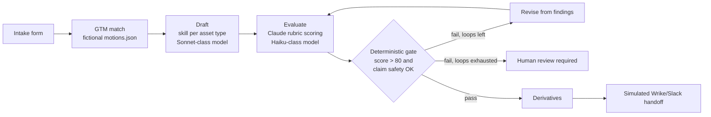

# ContentOS Architecture

ContentOS is an independent, fictional portfolio project that models an enterprise content workflow as a governed pipeline with explicit human ownership.

## Components

| Module | Responsibility |
|---|---|
| `contentos/skills.py` | One drafting skill per asset type (length + structure), the six-dimension rubric, risky-phrase list |
| `contentos/engine.py` | `generate`, `evaluate`, `revise`, `derive`, and the bounded `run_live` loop; `run_demo` returns the same result schema offline |
| `contentos/guard.py` | `Meter` (per-session token budget) and `DailyCap` (per-deployment daily run cap) |
| `contentos/core.py` | Intake dataclass, fictional GTM data, heuristic rubric and templates (demo mode and judge fallback) |
| `app.py` | Streamlit UI: intake, workflow graph, scorecards, attempt history, mode and access gating |
| `record_sample.py` | Records one real run to `data/sample_run.json` for free public viewing |

## Design decisions

1. **Hybrid evaluation.** Claude scores each rubric dimension with cited evidence and a fix; code computes the average and applies a claim-safety gate (risky phrases cap the score; safety below 60 fails regardless of average). The model cannot talk its way past the gate.
2. **Bounded loop.** At most 3 revision loops (default 2). The best-scoring attempt is returned, not necessarily the last. Failing runs escalate to human review rather than looping.
3. **Model tiering.** A stronger model drafts and revises; a smaller, cheaper model evaluates and writes derivatives.
4. **Cost safety for a public URL.** Three free-of-charge surfaces (recorded Claude sample, deterministic demo) plus live mode behind an access code, per-session run and token limits, a daily cap, and provider-side spend limits. Live mode fails closed if `ACCESS_CODE` is unset, unless `REQUIRE_ACCESS_CODE=false` is set for a deployment whose app-level viewer access is already restricted.
5. **Prompt-injection posture.** User direction and drafts are wrapped in tags and declared untrusted in the system prompt; outputs are only rendered as Markdown and never executed or sent anywhere.
6. **Graceful degradation.** Unparseable judge output falls back to the heuristic evaluator (labelled `heuristic-fallback`); budget exhaustion returns the best draft so far.

## Known limitations (state these openly)

- LLM-as-judge scores are uncalibrated and illustrative; they are not PMM, brand, or legal approval.
- `DailyCap` is in-memory, so it resets when the app restarts. Provider spend limits are the real backstop.
- Reference library is metadata only, not retrieval. Handoffs are simulated; there are no outbound integrations.
- No persistence, authentication, or audit log. Next steps: score calibration against human-rated samples, evaluator ensembles, exemplar retrieval with provenance, authenticated integrations.
